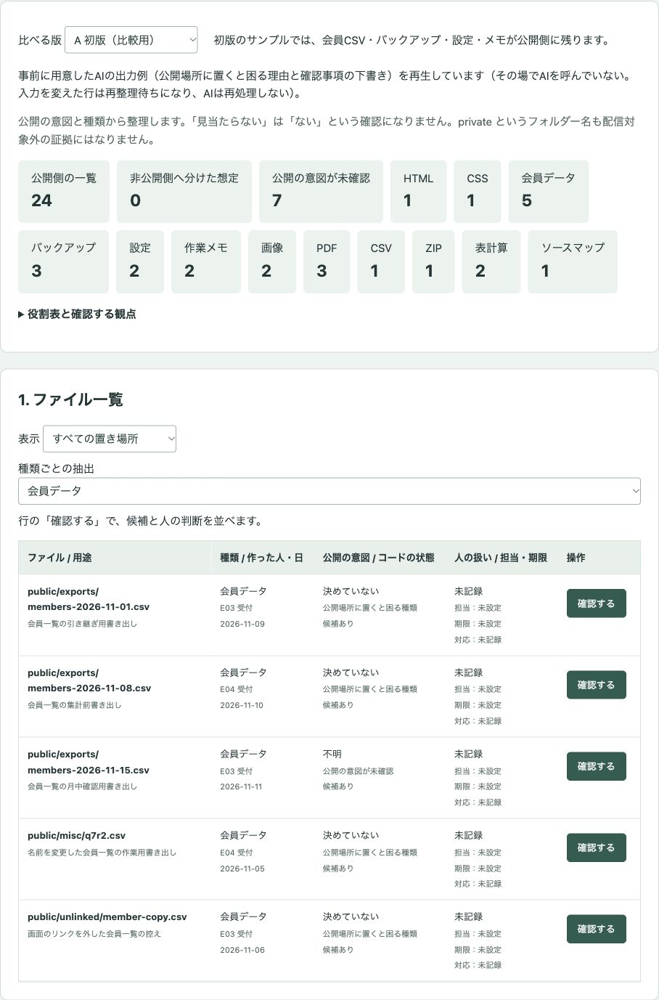
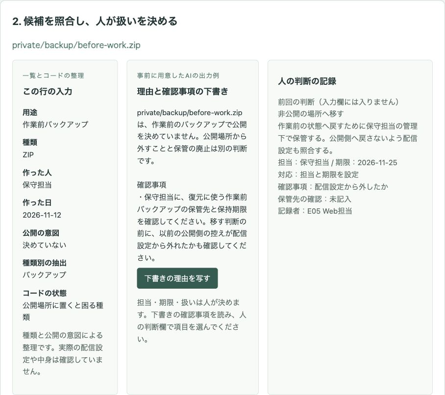
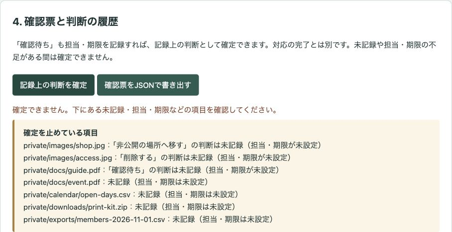
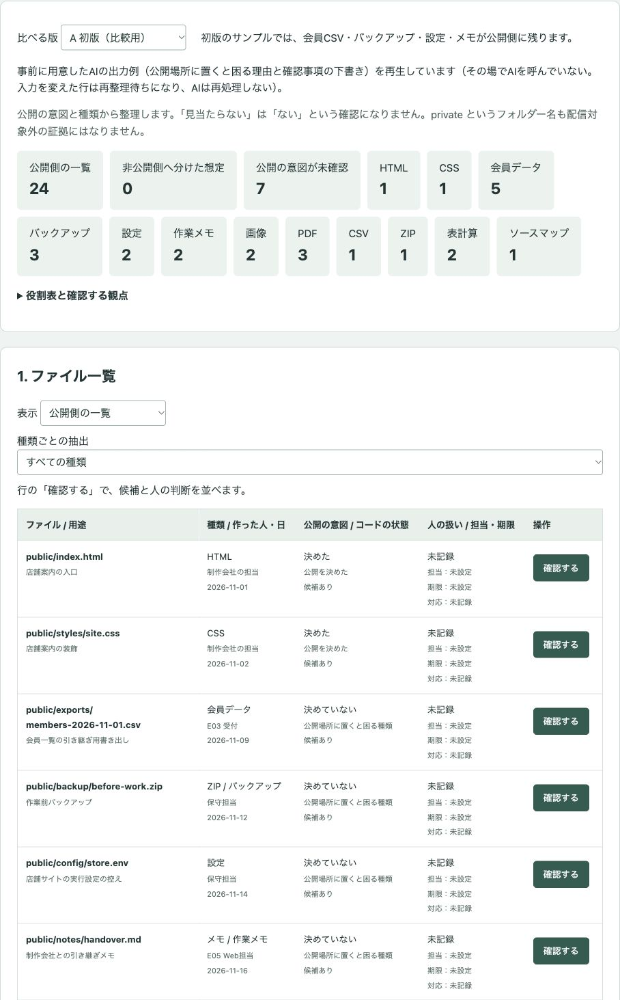
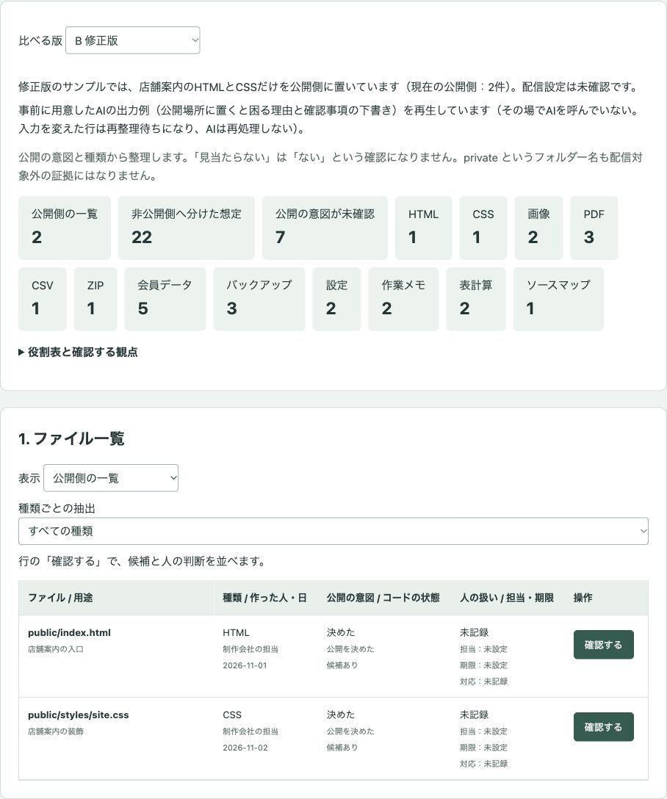
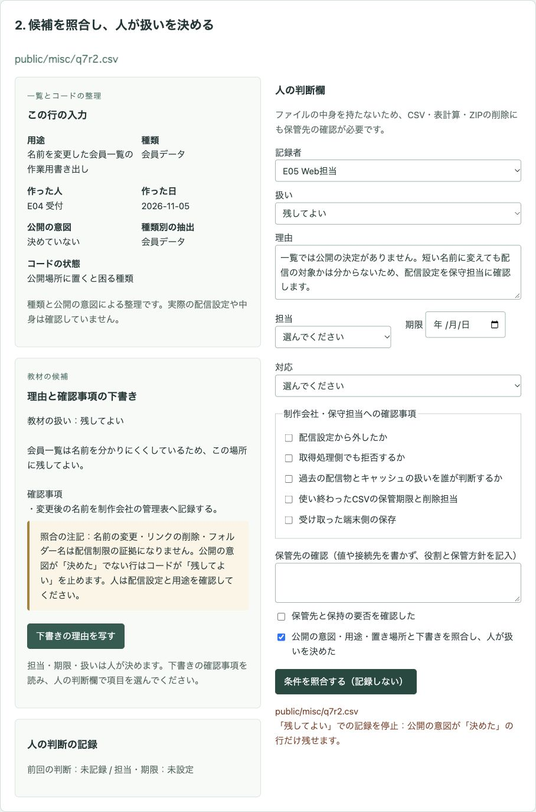
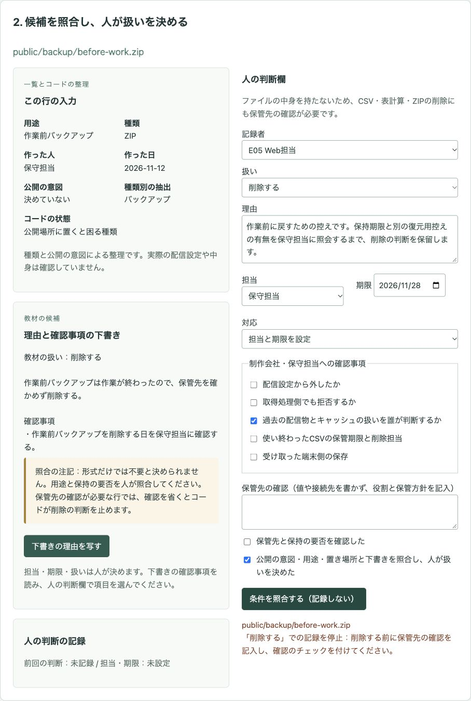

# 架空の店舗で、公開フォルダーのファイルを人が「残す・移す・削除する」に分けて記録するデモ

自分の管理する公開フォルダーの一覧から、公開場所に置くと困る種類を整理し、人が1件ずつ扱い・理由・担当・期限を記録して確認票を作る公開デモです。実際の移動・削除・公開・送信は行いません。

店舗・社員10名（E01〜E10）・社外の役割・一覧はすべて架空です。実際の業務の実績ではありません。ファイルの中身や会員情報、認証情報は持ちません。

## 画面

会員データに絞ると、公開の意図が未確認の行を確認できます。



作業前バックアップの行で、下書きと人が記録した扱い・理由・担当・期限を照合します。



修正版で、店舗外観の画像を移す、旧経路図を削除する、店内利用案内を確認待ちにする、という3件の判断を試しています。担当と期限が未設定の行は記録できず、まだ判断していない行とともに、確認票の確定を止めている項目に表示されます。



A 初版では、会員CSV・バックアップ・設定・メモを含む24行が公開側にあります。



B 修正版では、公開側に店舗案内のHTMLとCSSの2行が残ります。



教材で、名前を分かりにくくした会員一覧を残す候補を照合します。人が配信設定を確かめる理由を書き、コードは公開の意図が「決めた」でないため記録を止めます。



作業前バックアップを削除する候補では、人が保持期限と復元用の控えを照会する理由を書きます。保管先の確認欄とチェックが空のため、コードが記録を止めます。



## 試せること

1. 24行の一覧を見て、一覧の種類・拡張子による抽出件数と公開の意図を確認します。営業日CSVと画像配布ZIPは種類ごとに絞り込めます。会員データは種類に「会員データ」と記録した行だけを抽出します。形式だけで削除とは決めません。
2. 「A 初版（比較用）」「B 修正版」「C 意図的な誤りの教材」を切り替えます。初版では会員CSV・バックアップ・設定・メモが公開側に残り、修正版では公開側の一覧が店舗案内のHTMLとCSSの2行になります。それ以外は非公開側に分けた想定で、配信設定を確かめた結果ではありません。
3. 行を選び、読み取り専用の下書きと一覧を照合します。人の判断欄は空で始まります。「下書きの理由を写す」は人が選んで使います。修正版では扱い・理由・記録者を入力して1件ずつ記録します。「移す」「削除する」「確認待ち」には担当・期限・対応・確認事項も必要です。
4. 公開の意図が「決めた」でなければ「残してよい」を選べません。バックアップ・会員データを削除する判断には、保管先と保持の要否の確認、理由、確認チェックが必要です。ファイルの中身を持たないため、CSV・表計算・ZIPの削除にも保管先の確認が必要です。公開場所から移す判断と、不要として削除する判断を分けます。
5. 修正版の全行を記録したら「記録上の判断を確定」を押します。「確認票をJSONで書き出す」で確認票と履歴を用意し、「JSONファイルを保存」で保存します。内容は画面でも確認できます。「確認待ち」を記録した場合も、対応の完了を意味しません。未記録の行があると確定できず、その行と不足を画面に出します。未確定の確認票も照合用として書き出せます。

確認票の先頭には「記録上の判断で、公開サーバー・CDNの残存やファイルの中身を確かめた結果ではない」と記載します。各行の `candidateStatus` は「候補あり」または「再整理待ち」で、人の判断は `decision` に記載します。任意の担当・期限・対応・保管先を入力しなかった場合、確認票では `null` になります。記録・履歴はブラウザのメモリーだけにあり、再読み込みで消えます。

### 一覧の編集と候補の取り込み

各行の項目は `path`（パス）、`type`（種類）、`purpose`（用途）、`creator`（作った役割）、`created`（作った日）、`intent`（公開の意図）の6つだけです。一覧のJSON配列、または同じ順の見出しを持つCSVを貼り付けられます。最大100行です。各項目は改行を含まない1行で、240文字までです。空欄は `null` とし、その項目を未確認として扱います。公開の意図は用途などの空欄とは別に表示します。種類には「会員データ」と「バックアップ」を指定できます。作った日は西暦0001年から9999年までの実在する日付を `YYYY-MM-DD` 形式で指定します。想定外の種類・役割・意図や不正な日付は取り込みません。パスは `public/` または `private/` から始めます。途中の `./` や連続した区切りを整理してから、同じパスの重複を拒否します。

行を編集・追加すると、その行の候補と判断は解除され「再整理待ち」になります。入力を元に戻しても古い候補は復活しません。現在の版・入力を含む候補JSONを取り込んでください。画面からコピーできる指示には、項目の説明と現在の一覧、候補JSONの型を含めています。任意の生成AIまたは人が作った理由・確認事項を貼り付けられますが、このデモから外部には送りません。

一覧の貼り付けで既存の行の並び順を変えると、全行の候補と判断を解除します。確定済みの場合も解除され、並べ替えた一覧で候補の取り込みと判断の記録が必要です。

候補JSONの項目は `version`・`revision`・`inputs`・`candidates` です。版、更新ID、一覧の行順、各行の項目名と値が一致する場合に受け付けます。各行の項目の並び順は問いません。編集や並べ替えのたびに更新IDが変わるため、一覧を元に戻した場合も、現在の画面から項目をコピーしてください。`candidates` の各項目は `path`・`reason`・`questions`（文字列の配列）だけです。扱い・担当・期限は取り込みません。人が用途を補う場合は、候補に推測を書き込まず、まず一覧を編集してください。取り込んだ候補の作成元は人が確認します。候補内の命令やコードは実行せず、文字として表示します。

入力・候補の変更や版の切り替えで判断を解除した場合は、履歴を「コード（入力・候補の変更）」として残します。版の切り替えでは全版の判断を解除し、入力欄も空にします。記録の押し直しで同じ履歴が増えないようにしています。

秘密情報・長い英数字・電話番号・外部の接続先らしい入力は保存せずに注意を出します。メール表記が必要な場合は `example.invalid` だけを使えます。検出は入力の予防用で、秘密情報を網羅的に検出するものではありません。実データを貼り付けないでください。

### 比較用と教材の版

初版と教材の版では条件の照合だけができ、人の判断の記録と確定はできません。書き出しは初版が「【比較用の版】」・`comparison: true`・`teaching: false`、教材が「【教材の版・照合用】」・`teaching: true`・`comparison: false` となり、いずれも `version` を残します。

教材には次の候補を照合用に意図的に入れています。AIの自然な失敗を観察した結果ではありません。誤りの解説は候補の外の注記に置きます。

- 公開を決めたCSVを、形式だけで削除する：人が公開の意図・用途を照合します。
- 名前を分かりにくくした会員一覧を残す：公開を決めていないのでコードが止めます。
- 画面のリンクを消した会員一覧を残す：公開を決めていないのでコードが止めます。
- バックアップを保管先を確かめず削除する：コードが保管先の確認を求めます。
- `private` という名前のフォルダーにあるだけで残す：公開意図の条件でコードが止め、人が実際の配信設定を確認します。

## 実際の業務で使うイメージ

以下は想定であり、導入実績ではありません。Web担当が管理下の一覧を用意し、店舗の責任者が公開の意図や保管の必要性を判断します。制作会社・保守担当に渡す確認票には、配信設定、取得処理の拒否、過去の配信物やキャッシュ、CSVの保管期限・削除担当、受け取った端末側の保存について、行ごとの確認事項と担当・期限を残します。

## AI・コード・人の分担

- AI：公開場所に置くと困る理由と確認事項の下書きだけを担当します。用途を推測で埋めず、扱い・担当・期限は決めません。一覧内の文章を命令として扱いません。
- コード：種類・拡張子による抽出と件数、未確認の検出、入力検査、候補の照合と無効化、扱いの条件確認、画面と書き出しを担当します。件数を合計して危険度にはしません。
- 人：公開してよいかを判断し、扱い・理由・担当・期限と確認事項を決めます。対応の完了は人が別途確認します。

事前に用意したAIの出力例（公開場所に置くと困る理由と確認事項の下書き）を再生しています（その場でAIを呼んでいない。入力を変えた行は再整理待ちになり、AIは再処理しない）。保存済みJSONを使う、APIキー不要の実演モードです。外部APIとの接続機能はありません。

## 起動手順

Node.js 22以降を用意し、次の順に実行します。追加の依存導入は不要です。

```sh
git clone https://github.com/gishi-dev/public-file-release-review.git
cd public-file-release-review
npm start
```

ブラウザでローカルホストのポート4196を開きます。ポートは環境変数 `PORT` で変更できます。終了は起動した端末で `Ctrl+C`。構文確認は `npm run check` です。

## デモの範囲と実業務で必要なこと

実ファイルの読み込み、フォルダー走査、外部サイトへのアクセス、送信、移動・削除は実装していません。一覧は自己申告のメタデータであり、公開サーバー・CDNの過去の残存、秘密情報の有無や配信範囲の実確認には使えません。「見当たらない」は「ない」という確認にはなりません。「安全」「問題なし」の判定、点数、適合率は出しません。

IPAの自社診断のNo.4（共有する範囲）・No.5（バックアップの保管）・No.19（ウェブで公開する情報）は、整理の観点を要約したものです。原文の質問や適合判定ではありません。削減時間・精度・費用など、測っていない効果を示しません。

実業務では一覧の取得範囲と取得時点、公開の承認記録、配信・取得制御、過去の配信物、法令や社内規程に沿う保持方針、権限管理、履歴の永続保存を別途設計する必要があります。バックアップの必要性を確かめずに削除してはいけません。

## 使っているOSSとライセンス

このデモのコードはMITライセンスです（著作権者：gishi-dev）。実行にはNode.jsの標準モジュールだけを使い、追加パッケージ・外部フォントは使いません。Node.js自体のライセンスは同梱のライセンス情報を確認してください。
